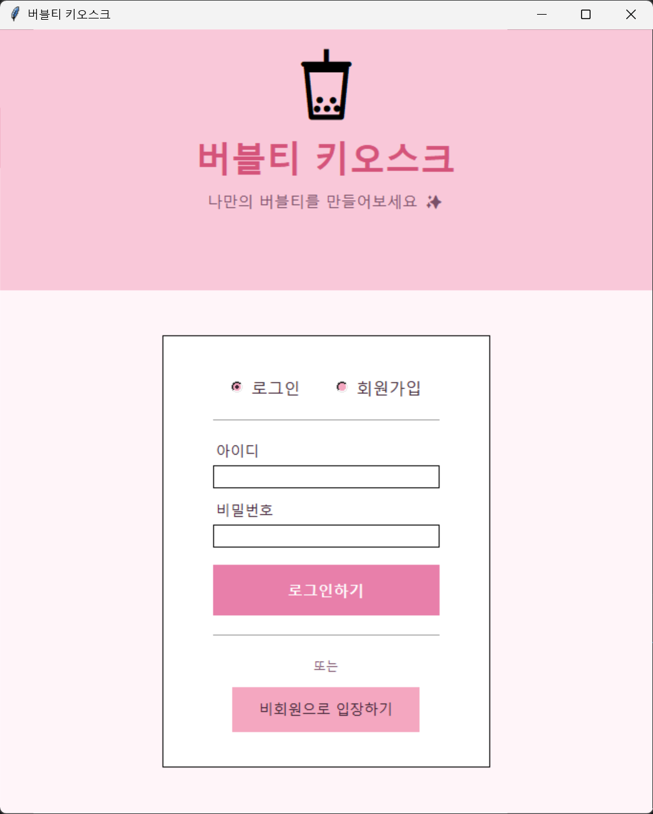
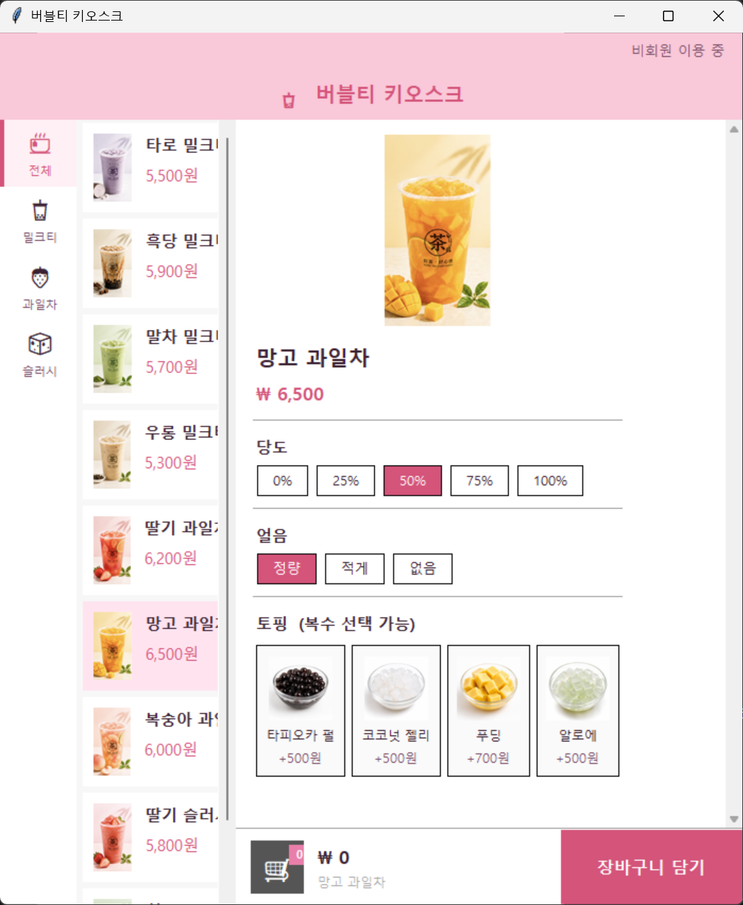
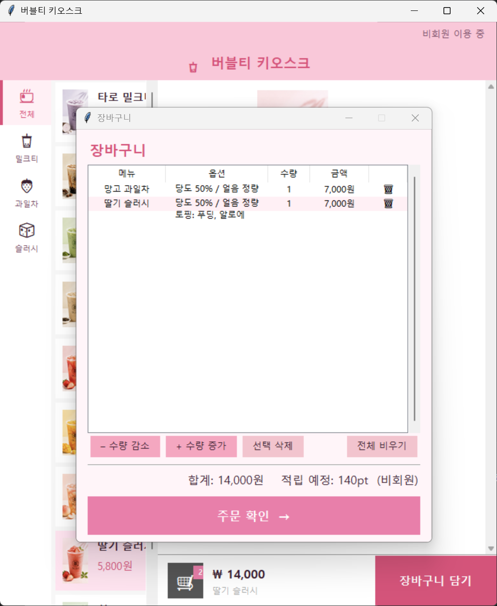
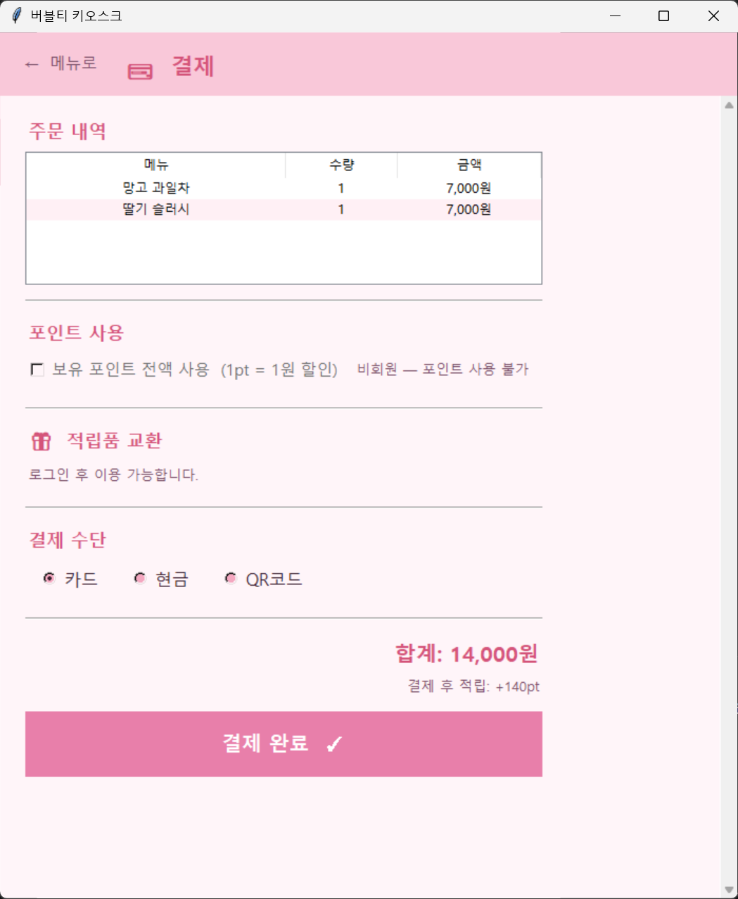
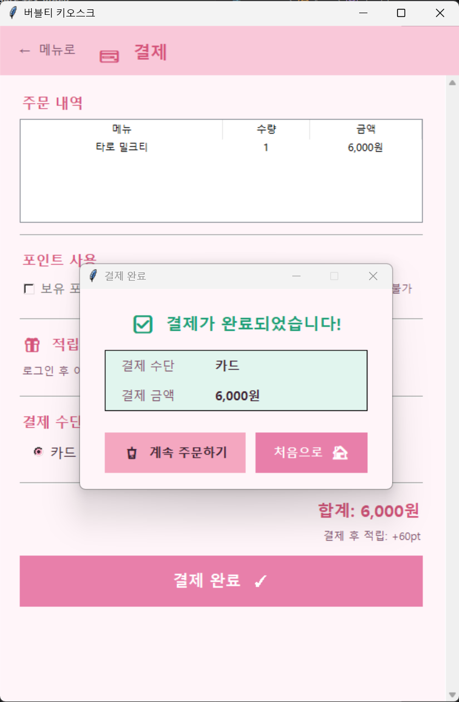

# Bubble Tea Kiosk System

## 프로젝트 소개

Bubble Tea Kiosk System은 Python과 Tkinter를 활용하여 개발한 버블티 전문점용 무인 주문 키오스크 프로그램입니다.

사용자는 회원 또는 비회원으로 서비스를 이용할 수 있으며, 메뉴 탐색, 음료 커스터마이징, 장바구니 관리, 결제, 포인트 적립 및 적립품 교환 기능을 사용할 수 있습니다.

본 프로젝트는 실제 버블티 매장의 주문 과정을 기반으로 설계되었으며, GUI 프로그래밍과 객체지향 프로그래밍(OOP)의 개념을 활용하여 구현하였습니다.

---

# 주요 기능

## 1. 회원 관리 기능

* 회원가입
* 로그인
* 비회원 주문 지원
* 회원 정보 저장 및 관리
* 포인트 적립 및 사용

---

## 2. 메뉴 조회 기능

사용자는 카테고리별로 메뉴를 조회할 수 있습니다.

### 메뉴 카테고리

* 밀크티
* 과일차
* 슬러시

각 메뉴는 다음 정보를 제공합니다.

* 메뉴 이미지
* 메뉴 이름
* 가격
* 상세 정보

---

## 3. 음료 커스터마이징 기능

사용자는 원하는 옵션을 선택하여 음료를 주문할 수 있습니다.

### 당도 선택

* 0%
* 25%
* 50%
* 75%
* 100%

### 얼음 선택

* 정량
* 적게
* 없음

### 토핑 추가

* 타피오카 펄
* 코코넛 젤리
* 푸딩
* 알로에

복수 선택이 가능합니다.

---

## 4. 장바구니 기능

사용자는 선택한 메뉴를 장바구니에 담을 수 있습니다.

제공 기능

* 메뉴 추가
* 수량 증가
* 수량 감소
* 선택 삭제
* 전체 비우기
* 총 금액 계산

---

## 5. 결제 기능

다음 결제 수단을 지원합니다.

* 카드 결제
* 현금 결제
* QR 코드 결제

결제 완료 후 주문이 저장됩니다.

---

## 6. 포인트 및 적립품 교환 기능

회원은 결제 금액에 따라 포인트를 적립할 수 있습니다.

### 포인트 기능

* 포인트 적립
* 포인트 사용
* 결제 금액 할인

### 적립품 교환

보유 포인트를 이용하여 적립품을 교환할 수 있습니다.

---

## 7. 데이터 저장 기능

프로그램 데이터는 JSON 파일을 사용하여 관리합니다.

저장 정보

* 회원 정보
* 메뉴 정보
* 주문 내역
* 포인트 정보
* 적립품 정보

---

# 시스템 흐름도

```text
로그인 / 비회원 입장
          ↓
      메뉴 선택
          ↓
 음료 옵션 선택
          ↓
    장바구니 담기
          ↓
      주문 확인
          ↓
      결제 진행
          ↓
      결제 완료
          ↓
 포인트 적립 및 저장
```

---

# 실행 화면

## 1. 로그인 및 회원가입 화면



사용자는 로그인, 회원가입 또는 비회원 모드를 선택하여 서비스를 이용할 수 있습니다.

---

## 2. 메뉴 조회 및 커스터마이징 화면



메뉴를 선택한 후 당도, 얼음, 토핑을 자유롭게 설정할 수 있습니다.

---

## 3. 장바구니 화면



주문한 메뉴를 확인하고 수량 변경 및 삭제가 가능합니다.

---

## 4. 결제 화면



주문 내역을 확인하고 원하는 결제 방식을 선택할 수 있습니다.

---

## 5. 결제 완료 화면



결제가 성공적으로 완료되면 결제 금액과 결제 수단을 확인할 수 있습니다.

---

# 사용 기술

| 구분                   | 기술                                |
| -------------------- | --------------------------------- |
| Programming Language | Python 3                          |
| GUI Framework        | Tkinter                           |
| Image Processing     | Pillow (PIL)                      |
| Data Storage         | JSON                              |
| Programming Method   | Object-Oriented Programming (OOP) |

---

# 프로젝트 구조

```text
bubble-tea-kiosk/

├── main.py
├── page_welcome.py
├── menu_frame.py
├── cart_frame.py
├── payment_frame.py
├── member_frame.py
│
├── data/
│   ├── menu.json
│   ├── members.json
│   ├── orders.json
│   └── rewards.json
│
├── images/
│   ├── login.png
│   ├── menu.png
│   ├── cart.png
│   ├── payment.png
│   └── complete.png
│
└── README.md
```

---

# 실행 방법

### 1. Python 설치

Python 3.10 이상 버전을 설치합니다.

### 2. 라이브러리 설치

```bash
pip install pillow
```

### 3. 프로그램 실행

```bash
python main.py
```

---

# 향후 개선 사항

* 관리자 페이지 추가
* 데이터베이스(MySQL) 연동
* 모바일 키오스크 지원
* 실시간 재고 관리 기능
* 매출 통계 분석 기능
* 회원 등급 시스템 추가

---

# 프로젝트 특징

본 프로젝트는 실제 버블티 매장의 주문 환경을 모방하여 제작된 GUI 기반 키오스크 시스템이다.

사용자는 메뉴 선택부터 음료 커스터마이징, 장바구니 관리, 결제 및 포인트 적립까지 전 과정을 경험할 수 있으며, 회원과 비회원 모두 이용할 수 있다.

또한 JSON 기반 데이터 저장 방식을 활용하여 간단하면서도 효율적인 주문 관리 시스템을 구현하였다.

---

# 프로젝트 정보

한양대학교 ERICA

인공지능학과

Team Project

프로그래밍기초 km team

Bubble Tea Kiosk System

